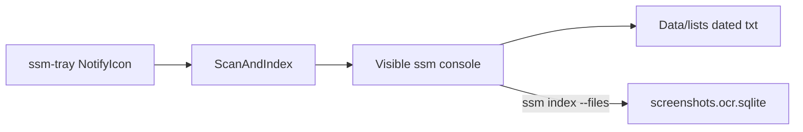

# Windows tray Scan and Index

## Goal

A small always-running Windows tray app so Scan then Index is one menu click. Paths come from ssm config (same resolution as [`scan.ts`](src/commands/scan.ts): `directories[0]`, else the platform default). Dated file lists go under the index data directory, not the home folder.

## Approach

Ship a PowerShell WinForms `NotifyIcon` script. No Electron, no new npm dependencies. The tray process stays light; the actual work runs in a separate console so the existing chalk progress bar from `ssm scan` / `ssm index` stays intact.



## Files

- [`scripts/windows/ssm-tray.ps1`](scripts/windows/ssm-tray.ps1) — tray UI and job control
- [`scripts/windows/Start-SsmTray.vbs`](scripts/windows/Start-SsmTray.vbs) — double-click / Start Menu entry that launches the tray with no console flash
- Short README note under Usage describing how to start the tray and what the menu does
- [`setup.ps1`](setup.ps1) creates a Start Menu shortcut to `Start-SsmTray.vbs` during install (and removes it on uninstall)

## Behavior

On start, the tray icon appears. Right-click menu:

- **Scan and Index** — disabled while a run is active. Resolves `ssm` from PATH (same as the installed `ssm.cmd` / `ssm.ps1`). Creates `%LOCALAPPDATA%\screenshot-memory\Data\lists\` if needed. Runs in a new console window:

```powershell
ssm scan --out "<lists>\<yyyy-MM-dd>_files.txt" --rejected "<lists>\<yyyy-MM-dd>_rejected.txt"
ssm index --files "<lists>\<yyyy-MM-dd>_files.txt"
```

  No directory argument: `ssm scan` already picks the configured directory. Balloon tip on start, success, or failure (exit code from the child process).

- **Show Progress** — focuses the job console if it is still open; if the run finished, opens the latest log file written beside the lists (`*_run.log` capturing console output via `Start-Transcript` or Tee-Object in the job script).

- **Open Lists Folder** — opens `Data\lists` in Explorer.

- **Exit** — refuses to quit while a run is active (balloon warning); otherwise disposes the icon and exits.

Only one Scan and Index job at a time. Closing the console mid-run is treated as a stop; the next click can start again (existing index resume still applies).

## Install UX

`setup.ps1` adds:

`%APPDATA%\Microsoft\Windows\Start Menu\Programs\screenshot-memory\Scan and Index (tray).lnk`

pointing at `Start-SsmTray.vbs` in the repo `scripts/windows` folder (or a copied install location next to the bun `ssm` shim if setup already copies scripts there). Uninstall removes that shortcut.

## Out of scope

- macOS / Linux tray
- Changing the TypeScript indexer or scan CLI
- Running the 10k-file index during implementation; manual smoke of the tray menu is enough
